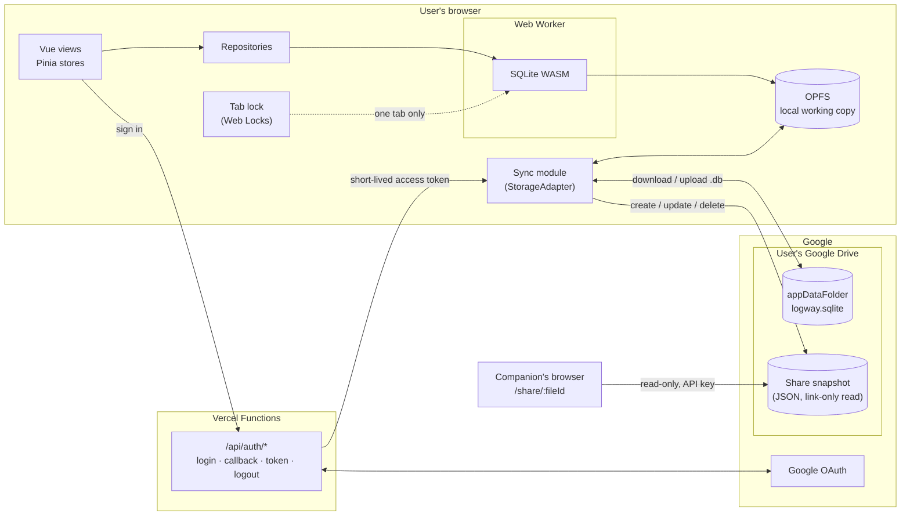

# logway

> [!WARNING]
> **LogWay v2 is under active development.**
> v2 is a major rewrite with changes to both the app and the tech stack. Features described below may be incomplete or still changing. Until v2 is released, the production site shows only a maintenance page. The previous version (v1) is kept at the [`v1.0.0`](https://github.com/ysengoku/logway/tree/v1.0.0) tag.

<!--  -->

<div align="center">
  
  
  
</div>

## Table of Contents

<details>
<summary>Click to Show / Hide</summary>

- [About](#about)
- [Features](#features)
- [Architecture](#architecture)
- [Project Structure](#project-structure)
- [Tech Stack](#tech-stack)
- [Getting Started](#getting-started)
  - [Prerequisites](#prerequisites)
  - [Installation](#installation)
  - [Usage](#usage)
- [Development](#development)
  - [Workflow](#workflow)
  - [Linting & Formatting](#linting--formatting)
  - [Testing](#testing)
- [Versioning](#versioning)
- [Notes](#notes)
- [Resources](#resources)
- [Authors](#authors)
- [License](#license)

</details>

## About

LogWay is a web app for managing travel itineraries. Each trip brings together flights, trains, buses, accommodation, restaurants, activities and useful links, all organized in a calendar view.

LogWay has no backend database. Instead, it stores data in a SQLite database directly in the browser and syncs it with the user's own cloud storage (currently Google Drive). This keeps users in control of their data, which remains in their own cloud account.

## Features

- Sign-in with Google 
- Trips: create, edit and delete; the home page splits them into upcoming and past trips
- Events: flight, transport (train, bus, ferry, car, other), hotel, restaurant, activity and link
- Local date, time and time zone for both departure and arrival of flights and transport
- Calendar view of each trip with a per-day list of events
- Sync to a hidden app folder in the user's cloud storage; changes made on another device are never silently overwritten 
- Read-only share links for travel companions (booking references are never shared; notes only when chosen) 
- Interface available in English and French, switchable from the header

## Architecture



The server stores no trip data. Vercel Functions only handle Google OAuth and keep the refresh token in an encrypted httpOnly cookie. The browser calls the Drive API directly with a short-lived access token.

## Project Structure

```
logway/
├─ app/                    # Vercel root directory
│  ├─ api/                 # Vercel functions
│  │  ├─ auth/
│  │  └─ _lib/
│  ├─ src/
│  │  ├─ db/               # SQLite in a Web Worker, migrations, tab lock
│  │  ├─ repositories/     # Data access for trips and events
│  │  ├─ stores/           # Pinia stores
│  │  ├─ views/            # Route-level pages
│  │  ├─ components/       # UI components (forms, modals, event cards, header)
│  │  ├─ shared/types/     # Shared TypeScript types
│  │  ├─ constants/        # Event types, languages, regex
│  │  ├─ lib/              # Font Awesome icons, initial locale
│  │  ├─ locales/          # en, fr
│  │  ├─ router/
│  │  ├─ validators/
│  │  ├─ utils/
│  │  └─ assets/styles/
│  ├─ __tests__/unit/      # Vitest unit tests
│  ├─ public/
│  └─ package.json, vite.config.ts, vercel.json, tsconfig*.json, .env.example
├─ docs/                   # Migration plan, database notes, archived Supabase migrations
├─ .github/workflows/      # CI and manual preview deploy
└─ .coderabbit.yaml        # CodeRabbit review settings
```

## Tech Stack

<!-- Use utils/TECH_STACK_LIST.md -->

**Languages:**   

<div>   
  
  
  
</div>
<br />

**Frameworks & Libraries:**   

<div>
  
  
  
  
</div>
<br />

**Database:**   

<div>
  
</div>
<br />

**Authentication & Cloud Storage:**   

<div>
  
  
  <!--  -->
</div>
<br />

**Tools:**   
<div>
  
  
  
  
  
  
  
</div>
<br />

**Infrastructure:**   
<div>
  
</div>
<br />

**Development Environment:**   
<div>
  
</div>

## Getting Started

### Prerequisites

- Node.js 26
- pnpm 10
- [Vercel CLI](https://vercel.com/docs/cli) (runs the OAuth functions locally)
- A Google Cloud OAuth client (web application) with the Google Drive API enabled

### Installation

```sh
git clone https://github.com/ysengoku/logway.git
cd logway/app
pnpm install
```

Copy the example environment file and fill in the values (each variable is described in the file):

```sh
cp .env.example .env
```

On Vercel, set the same variables in the project settings.

### Usage

```sh
vercel dev        # app + OAuth functions
pnpm dev          # app only, without sign-in
pnpm build        # type-check and production build
```

## Development

### Workflow

- Work happens on feature branches and is merged into `v2` through pull requests, which CodeRabbit reviews automatically.
- `main` is the default branch and is deployed to production by Vercel. Until v2 is released, production runs in maintenance mode, and `v2` will be merged into `main` again for the release.
- Preview deployments are started manually from GitHub Actions (*Run workflow*), for any branch.
- CI (lint, type check, unit tests, build) runs on pushes to `main` and `v2`, and can also be started manually.

### Linting & Formatting

Oxlint runs first and ESLint covers the rest; `eslint-plugin-oxlint` turns off the ESLint rules that Oxlint already checks.

```sh
pnpm lint         # fix what can be fixed
pnpm lint:ci      # check only (used in CI)
pnpm format       # Prettier
```

### Testing

Unit tests use Vitest and live in `app/__tests__/unit/`. Repository and migration tests run against a real in-memory SQLite database (the same WebAssembly build as the app), not mocks.

```sh
pnpm test:unit
pnpm exec vitest run __tests__/unit/db/migrate.test.ts   # single file
```

## Versioning


#### v2.0.0 

- Trip data stored in SQLite in the browser and synced to the user's own Google Drive, with no backend database
- Single Vue app deployed on Vercel, with Vercel Functions for Google OAuth
- Collaborative editing from v1 is removed; trips are shared with travel companions through read-only links only

#### v1.0.0

- Vue frontend deployed on Vercel
- Hono API server deployed on Render
- Supabase for the database and authentication
- Collaborative trips: other users join with an invite code and edit the trip together

## Notes

- Only one browser tab can open LogWay at a time. The local database (OPFS, `opfs-sahpool` VFS) supports a single connection, so later tabs show a message instead of the app.
- LogWay requires an internet connection and browser storage (OPFS). If either is unavailable, the app shows an error screen instead of letting users make changes that can't be saved.
- Share links are public to anyone holding the URL; turning sharing off deletes the snapshot.
- Setting `VITE_MAINTENANCE_MODE=true` replaces the whole app with a maintenance page, without opening the local database. The variable is read at build time, so redeploy after changing it.

## Resources

- [SQLite WebAssembly](https://sqlite.org/wasm/doc/trunk/index.md)
- [Origin Private File System (MDN)](https://developer.mozilla.org/en-US/docs/Web/API/File_System_API/Origin_private_file_system)
- [Web Locks API (MDN)](https://developer.mozilla.org/en-US/docs/Web/API/Web_Locks_API)
- [Google Drive API: Store application-specific data](https://developers.google.com/workspace/drive/api/guides/appdata)
- [Vercel Functions](https://vercel.com/docs/functions)

## Authors

- [ysengoku](https://github.com/ysengoku)

## License

This project is licensed under the [MIT License](LICENSE).
