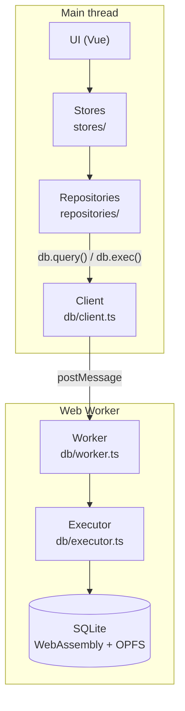
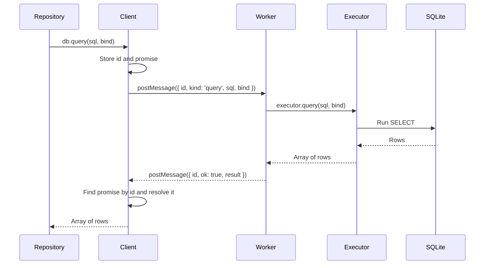
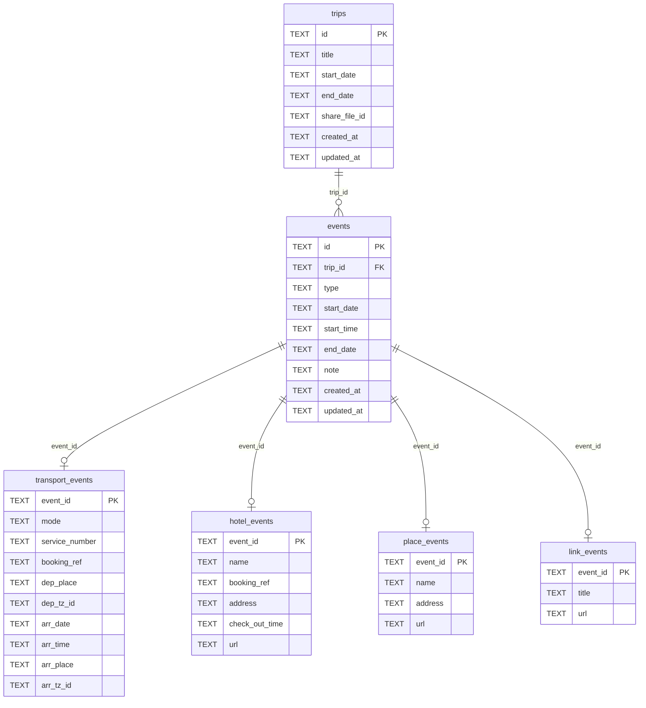
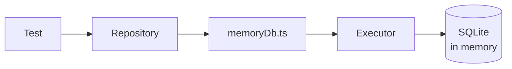

# Database

How the app uses SQLite in the browser, from the UI down to storage.

## Layers

| Layer | File | Responsibility |
|---|---|---|
| Stores | `stores/` | Hold UI state and call repositories |
| Repositories | `repositories/` | Validate input and run reads and writes |
| Client | `db/client.ts` | Implement `Db` by sending requests to the worker and returning promises |
| Worker | `db/worker.ts` | Open SQLite, pass requests to the executor, and send responses |
| Executor | `db/executor.ts` | Call the SQLite API. `exec` runs in a transaction |

SQL statements are written in repositories and migrations. The other layers pass them along or run them.

## Web Worker

- The synchronous access handles that OPFS needs for fast writes are only available in workers.
- SQLite work doesn't block the UI.
- The `opfs-sahpool` VFS doesn't need COOP/COEP headers, but only one tab can open it at a time. `db/tabLock.ts` limits the app to one tab.

## Requests and responses

Each request has an `id`, so a response can be matched to its request regardless of order.

On failure, the worker sends `{ id, ok: false, error }` and the client rejects the promise.

## Startup and migrations

`getDb()` starts the worker and runs migrations once, then returns the same promise on later calls.

1. `db/client.ts` starts the worker.
2. `migrate(db)` reads `schema_version` from the `meta` table.
3. Newer files in `db/migrations/NNN_*.sql` run in version order.
4. Each migration and its version update run in the same transaction.

## Tables

`events` holds the fields shared by every event type, and detail tables hold the type-specific fields. Reads go through the `event_details` view, which joins them.

| `events.type` | Detail table | Rules |
|---|---|---|
| `flight` | `transport_events` | `mode` is `flight`; number and time required |
| `transport` | `transport_events` | Mode and time required |
| `hotel` | `hotel_events` | `end_date` is the check-out date and must be after `start_date` |
| `restaurant` | `place_events` | Time required |
| `activity` | `place_events` | Time optional |
| `link` | `link_events` | Title and URL required |

`events.end_date` is the last day an event appears on the calendar. For hotels it is the check-out date. For flights and transport it is the later of `start_date` and `transport_events.arr_date`, so overnight trips also appear on the arrival day. For other types it equals `start_date`.

The `meta` table stores information about the database itself, such as `schema_version`. `db/migrate.ts` creates it.

## Writes

All statements passed to one `db.exec()` call run in a single transaction. Saving an event passes `events` and its detail table to the same call, so one can't be saved without the other.

| Operation | SQL |
|---|---|
| Create | INSERT into `events`, INSERT OR REPLACE into the detail table |
| Update | UPDATE `events`, INSERT OR REPLACE into the detail table |
| Delete | DELETE from `events`; `ON DELETE CASCADE` removes the detail row |

`INSERT OR REPLACE` deletes the existing row before inserting. Don't use it on `trips` or `events`, because it can also delete their child rows.

Foreign keys must be enabled per connection, so `db/executor.ts` runs `PRAGMA foreign_keys = ON`.

## Tests

Tests skip the worker and OPFS. `__tests__/unit/helpers/memoryDb.ts` passes an in-memory SQLite database to the executor. Repositories still see a `Db`, so the same code runs in both cases.

